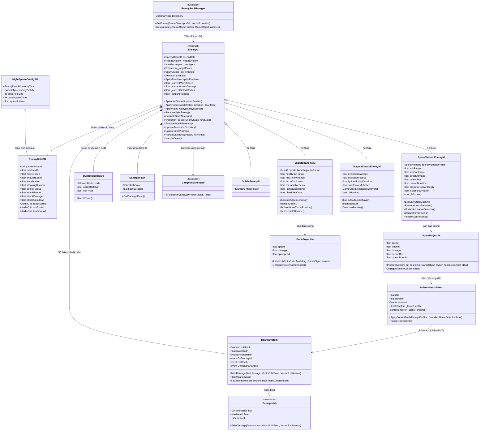
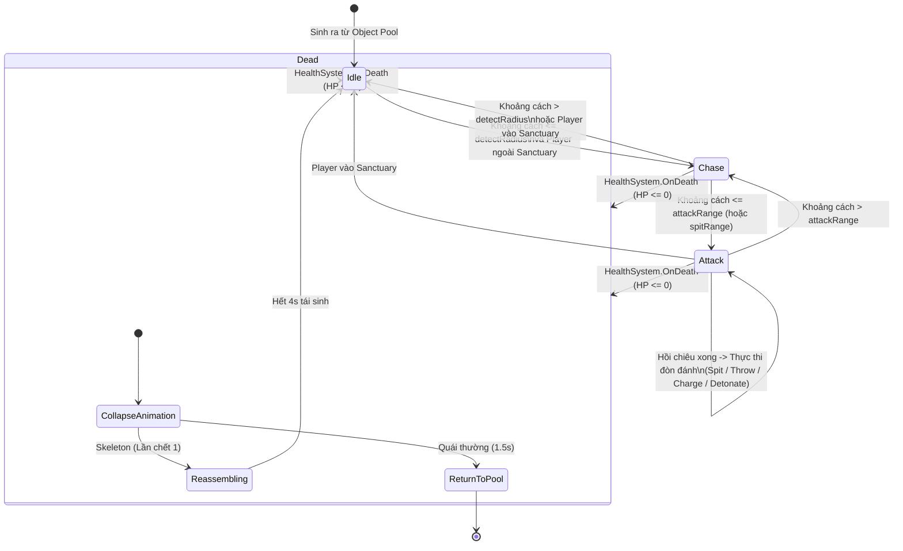

# 🏛️ Báo Cáo Kiến Trúc Hệ Thống Quái Vật (Monster System Architecture)
**Dự Án:** *Find the Lover* — 2.5D Action Survival / Environmental Puzzle  
**Tác Giả:** Teka (Unity Game Tester & Gameplay Engineer)  
**Tài Liệu Kỹ Thuật:** Phục vụ báo cáo thực tập & phát triển dự án  
**Phiên Bản Unity:** Unity 6 LTS (`6000.4.0f1`) URP  

---

## 1. Tổng Quan Kiến Trúc (Architecture Overview)

Hệ thống quái vật trong *Find the Lover* được thiết kế theo mô hình **3 Tầng Phân Tách (3-Tier Decoupled Architecture)** kết hợp với chuẩn mực **SOLID**, giúp tách biệt hoàn toàn giữa **Dữ liệu (Data)**, **Hành vi logic (Logic)** và **Hiển thị hình ảnh (Presentation)**.

```
┌────────────────────────────────────────────────────────┐
│             DATA LAYER (ScriptableObjects)             │
│        EnemyDataSO, NightSpawnConfigSO (Flyweight)     │
└───────────────────────────┬────────────────────────────┘
                            │ Đọc thông số tĩnh
┌───────────────────────────▼────────────────────────────┐
│              LOGIC LAYER (MonoBehaviours)              │
│       EnemyAI (Base FSM), SporeShroom, Skeleton...     │
│   HealthSystem, IDamageable, NavMesh, Object Pooling   │
└───────────────────────────┬────────────────────────────┘
                            │ Điều khiển tham số / Sự kiện
┌───────────────────────────▼────────────────────────────┐
│             PRESENTATION LAYER (View & Art)            │
│   DynamicBillboard, SpriteRenderer, 2D BlendTrees,     │
│   DamageFlash, VFX Particle & Spore/Bone Projectiles   │
└────────────────────────────────────────────────────────┘
```

### Các Nguyên Tắc Cốt Lõi:
1. **Data-Driven (Flyweight Pattern):** Mọi chỉ số cân bằng (Máu, Tốc độ, Tầm nhìn, Sát thương, Hồi chiêu) nằm trong `ScriptableObject` (`EnemyDataSO`). Toàn bộ hàng trăm quái vật cùng loại trên Scene chỉ chia sẻ **một bản thiết kế duy nhất** trong RAM, không tốn thêm bộ nhớ.
2. **Kế Thừa & Đa Hình (Inheritance & Polymorphism):** Class cha `EnemyAI` chứa toàn bộ khung logic dùng chung (FSM, NavMesh, Nhận sát thương, Đổi màu chớp đỏ, Buff Cuồng Nộ Ban Đêm). Các quái con (`Goblin`, `Skeleton`, `MagmaScarab`, `SporeShroom`) chỉ việc ghi đè các hàm đặc thù (`ExecuteAttackBehavior`, `UpdateAnimationDirection`, `HandleDeath`).
3. **Zero Garbage Collection (Object Pooling):** Không dùng `Instantiate()` và `Destroy()` bừa bãi trong trận đánh. Toàn bộ quái vật được tái chế qua `EnemyPoolManager`.

---

## 2. Sơ Đồ Lớp Tổng Thể (Comprehensive UML Class Diagram)

Dưới đây là sơ đồ lớp chi tiết của toàn bộ hệ thống quái vật và các thành phần liên kết:



---

## 3. Phân Tích 4 Archetype Quái Vật (Monster Deep-Dive)

### 3.1. Forest Goblin (`GoblinEnemyAI`) — *Melee Swarm Rusher*
* **Khu vực:** Zone 1 — Emerald Coast.
* **Vai trò Gameplay:** Quái cận chiến tốc độ cao, xuất hiện theo bầy để tạo áp lực di chuyển lên người chơi.
* **Cơ chế chiến đấu:**
  * Di chuyển nhanh (`Speed = 3.5m/s`).
  * Khi vào tầm đánh (`AttackRange = 1.2m`), vung vuốt cào người chơi (`Damage = 12 DMG`).
  * Tận dụng đòn đánh để ép người chơi phải thành thạo thao tác Roll (Lăn né) và đòn chém Combo 3 nhịp.

### 3.2. Skeleton Goblin (`SkeletonEnemyAI`) — *Mid-Range Skirmisher & Reassembly*
* **Khu vực:** Zone 1 (Ban đêm) & Hầm Mộ Cổ.
* **Vai trò Gameplay:** Quái quấy nhiễu tầm trung kết hợp cơ chế hồi sinh bất ngờ.
* **Hai cơ chế độc quyền:**
  1. **Ném Xương Tầm Trung (Bone Throw):** Khi người chơi đứng ở khoảng cách từ $3.0\text{m}$ đến $8.5\text{m}$, Skeleton rút xương ném xoay tròn gây sát thương tầm xa.
  2. **Giả Chết & Tái Sinh Đống Xương (False Death & Reassembly):** Khi bị đánh tụt máu lần đầu, Skeleton không chết hẳn mà sụp xuống thành đống xương vụn có $1\text{ HP}$. Sau $4.0\text{s}$, nó sẽ tái sinh lại đầy cây máu nếu người chơi không kịp chạy tới bồi thêm một đòn kết liễu.

### 3.3. Magma Scarab (`MagmaScarabEnemyAI`) — *Kamikaze Explosive Charger*
* **Khu vực:** Zone 5 — Volcanic Sanctum.
* **Vai trò Gameplay:** Quái bọ cảm tử áp lực cao, buộc người chơi phải ưu tiên tiêu diệt từ xa hoặc căn giờ né đòn hoàn hảo.
* **Cơ chế tự nổ (Detonation Mechanism):**
  * Lao nhanh về phía người chơi (`Speed = 4.0m/s`).
  * Khi cách người chơi $< 2.0\text{m}$, nấm bọ kích hoạt đếm ngược tự nổ ($0.85\text{s}$). Bụng bọ phình to gấp $1.25$ lần (`swellScaleMultiplier`), chớp đỏ dồn dập để báo hiệu trước đòn đánh (Telegraphing).
  * **Cơ chế Hóa Giải (Defuse Mechanic):** Nếu người chơi nhanh tay chém chết bọ trước khi đồng hồ đếm ngược $0.85\text{s}$ kết thúc, vỏ bọ sẽ vỡ vụn vô hại (`Rupture`) mà **không hề phát nổ**. Nếu thất bại, nó nổ tung gây sát thương diện rộng khủng khiếp ($45\text{ DMG}$, bán kính $3.2\text{m}$).

### 3.4. Spore Shroom (`SporeShroomEnemyAI`) — *Biological Acid Turret & Creeping Stalker*
* **Khu vực:** Zone 2 — Toxic Swamp (Đầm Lầy Độc).
* **Vai trò Gameplay:** Ụ súng sinh học tầm xa kiêm quái rình rập, gây DoT độc rút máu theo thời gian.
* **Các cơ chế kỹ thuật tiên tiến:**
  1. **Bắn Bào Tử Axit (Acid Spit):** Bắn đạn cầu độc tầm xa $8.0\text{m}$, gây $10\text{ DMG}$ va chạm trực tiếp và truyền hiệu ứng `PoisonStatusEffect` (rút $2\text{ HP/s}$ trong $5\text{s}$, tổng cộng $10\text{ DMG}$ độc, đổi màu người chơi sang xanh lá).
  2. **Hành Vi Rình Rập (Creeping Stalker Combat Loop):** Giữa các phát bắn ($2.5\text{s}$ hồi chiêu), nấm không đứng đông cứng mà từ từ bò áp sát người chơi ($> 3.5\text{m}$) với tốc độ rình rập, duy trì căng thẳng chiến trận.
  3. **Khóa Hướng Nhìn Chính Diện 2.5D (Frontal Priority):** Khắc phục lỗi đi ngang như cua (Crab-walking). Mọi góc chéo trước mặt đều được ép về hoạt ảnh chính diện (`Spore_Shroom_Walk_fw`), thể hiện uy lực của chiếc miệng gỗ to lớn.

---

## 4. Máy Trạng Thái Hữu Hạn FSM (Finite State Machine Flow)

Tất cả quái vật đều vận hành trên cỗ máy trạng thái FSM kế thừa từ `EnemyAI`:



### Xử Lý Ngoại Lệ Toàn Cục:
* **Vùng Lửa Trại An Toàn (`CampfireSanctuary`):** Khi Player bước vào vùng ánh sáng lửa trại, mọi quái vật lập tức hủy bỏ truy đuổi và quay về trạng thái `Idle`, bảo vệ người chơi khi hồi phục.
* **Cuồng Nộ Ban Đêm (`NightFrenzy`):** Khi `DayNightCycleManager` thông báo trời tối, mọi quái vật nhận hệ số nhân: Tốc độ $\times 1.2$, Sát thương $\times 1.5$, Bán kính phát hiện $\times 1.3$, mắt phát sáng đỏ rực (`Eye_Light` / `Eye_Glow`) và toàn thân đổi sang sắc đỏ hung hãn.

---

## 5. Quy Chuẩn Hiển Thị Đồ Họa 2.5D (Presentation Pipeline)

### 5.1. Công Thức Chuẩn Hóa Pixels Per Unit (PPU)
Để mọi hoạt ảnh có kích thước hiển thị đồng bộ trong không gian 3D URP, PPU được tính toán dựa trên **chiều rộng thực tế của nhân vật ($W_{\text{char}}$)** thay vì chiều cao ô ảnh:

$$\text{PPU} = \frac{\text{Độ rộng nhân vật trong Spritesheet (px)}}{\text{Bề ngang mong muốn trong thế giới 3D (m)}}$$

* Với Spore Shroom: Bề ngang chuẩn $1.71\text{m}$.
  * `Idle` ($342\text{ px}$): $\text{PPU} = 200 \rightarrow 1.71\text{m} \times 3.29\text{m}$.
  * `Walk_fw` ($333\text{ px}$): $\text{PPU} = 135 \rightarrow 2.47\text{m} \times 2.84\text{m}$ (To lớn, oai vệ, bằng Idle).
  * `Walk_r` ($250\text{ px}$): $\text{PPU} = 175 \rightarrow 1.43\text{m} \times 3.41\text{m}$ (Bằng $100\%$ chiều cao Idle).
  * `Hurt` ($206\text{ px}$): $\text{PPU} = 120 \rightarrow 1.72\text{m}$ (Không bị phình to $4\text{m}$).
  * `Die` ($214\text{ px}$): $\text{PPU} = 125 \rightarrow 1.71\text{m}$ bắt đầu và $3.08\text{m}$ khi tan rã (Không bị tràn màn hình $7\text{m}$).

### 5.2. Công Thức Tiếp Đất Hoàn Hảo (Custom Grounding Pivot Y)
Để triệt tiêu lỗi sprite bị nhấc bổng lên không trung khi đổi animation:

$$\text{pivot.y} = \frac{1.45\text{m} \times \text{PPU} + \text{Khoảng cách từ chân nấm tới đáy ô (px)}}{\text{Chiều cao ô ảnh (px)}}$$

* **Kết quả:** Điểm tiếp xúc chân nấm luôn đạt chính xác $y = 0.00\text{m}$ (mặt cỏ) ở tất cả các trạng thái.

### 5.3. Cấu Hình BlendTree Animator Chuẩn
* Sử dụng chế độ **`SimpleDirectional2D`** với 4 hướng:
  * $(0.0, -1.0) \rightarrow \text{Forward (Chính diện nhìn xuống)}$
  * $(0.0, 1.0) \rightarrow \text{Backward (Sau lưng nhìn lên)}$
  * $(1.0, 0.0) \rightarrow \text{Right (Nghiêng phải)}$
  * $(-1.0, 0.0) \rightarrow \text{Left (Nghiêng trái)}$
* Tránh dùng `FreeformDirectional2D` khi không có điểm gốc $(0, 0)$, vì sẽ làm sai lệch trọng số sang hướng ngang.

---

## 6. Bảng Ma Trận Cân Bằng Chỉ Số Quái Vật (Monster Metrics Matrix)

| Thuộc Tính (Attribute) | Forest Goblin | Skeleton Goblin | Magma Scarab | Spore Shroom |
| :--- | :---: | :---: | :---: | :---: |
| **Khu vực (Zone)** | Zone 1 (Bờ biển) | Zone 1 & 2 (Đêm) | Zone 5 (Núi lửa) | Zone 2 (Đầm lầy độc) |
| **Máu Tối Đa (Max HP)** | $35\text{ HP}$ | $40\text{ HP}$ ($+1\text{ HP}$ đống xương) | $25\text{ HP}$ (Máu giấy) | $50\text{ HP}$ (Ụ nấm dẻo dai) |
| **Tốc Độ Chạy (Move Speed)** | $3.5\text{ m/s}$ | $2.5\text{ m/s}$ | $4.0\text{ m/s}$ | $1.5\text{ m/s}$ (Bò $1.2\text{ m/s}$) |
| **Tầm Phát Hiện (Detect Radius)** | $8.0\text{ m}$ | $9.0\text{ m}$ | $7.0\text{ m}$ | $10.0\text{ m}$ |
| **Tầm Tấn Công (Attack Range)** | $1.2\text{ m}$ (Cận chiến) | $1.5\text{ m}$ (Cắn) / $8.5\text{ m}$ (Ném) | $2.0\text{ m}$ (Tự nổ) | $8.0\text{ m}$ (Phun bào tử) |
| **Sát Thương Gốc (Base DMG)** | $12\text{ DMG}$ | $10\text{ DMG}$ (Cào) / $15\text{ DMG}$ (Xương) | $45\text{ DMG}$ (AoE tự nổ) | $10\text{ DMG}$ $+ 10\text{ DoT}$ ($2\text{/s}$) |
| **Thời Gian Hồi Chiêu (Cooldown)** | $1.2\text{ s}$ | $2.0\text{ s}$ | Không có (1 lần chết) | $2.5\text{ s}$ |
| **Cơ Chế Độc Quyền** | Tấn công hội đồng bầy đàn | Tái sinh đống xương sau 4s | Phình bụng đếm ngược $0.85\text{s}$ | Bào tử DoT rút máu & rình rập |
| **Khắc Chế Chiến Thuật (Counterplay)** | Chém Combo 3 nhịp hất văng | Bồi thêm đòn khi đang rã xương | Chém chết trong $0.85\text{s}$ để vô hiệu | Áp sát né đạn, chém tầm gần |

---

## 7. Khung Kiểm Thử QA Thực Chiến (QA/QC Test Case Matrix)

Dành cho vị trí **Game Tester** phục vụ nghiệm thu và viết báo cáo chất lượng:

| Test Case ID | Feature / Method | Tiền Điều Kiện (Pre-condition) | Các Bước Thực Hiện & Dữ Liệu Đầu Vào | Kết Quả Mong Đợi (Expected Result) | Rủi Ro & Lỗi Tiềm Ẩn (Edge Cases) |
| :--- | :--- | :--- | :--- | :--- | :--- |
| **TC_AI_01** | **FSM — Sanctuary Check** | Quái đang ở trạng thái `Chase` đuổi theo Player | Player bước qua ranh giới vòng lửa trại `CampfireSanctuary` | Quái lập tức hủy truy đuổi, chuyển về `Idle` đứng chờ ngoài rìa | Quái đi xuyên ranh giới nếu NavMesh bị bake lỗi chồng lấn |
| **TC_AI_02** | **FSM — Night Frenzy Buff** | Quái đang sống trên Scene lúc 17:59 (Hoàng hôn) | Gọi sự kiện `OnNightStarted` chuyển sang ban đêm | Quái tăng máu/tốc độ/sát thương, mắt đỏ rực, đổi màu `frenziedColor` | Khi trời sáng (`OnDayStarted`), chỉ số và màu sắc phải hồi phục nguyên bản |
| **TC_AI_03** | **Spore Shroom — Frontal Priority** | Player đứng ở góc chéo phía dưới nấm (Góc $30^\circ - 45^\circ$) | Cho Player di chuyển chậm trong tầm nhìn của nấm | Nấm quay mặt thẳng (`_fw`) và bước thẳng tới, không đi ngang kiểu cua (`_r`) | Nếu Player chạy ra ngang sườn ($> 75^\circ$), nấm phải chuyển mượt sang nhìn nghiêng |
| **TC_AI_04** | **Spore Shroom — DoT Poison** | Player đầy máu ($100\text{ HP}$), không có khiên | Đứng yên cho Spore Shroom phun trúng 1 viên đạn bào tử | Mất ngay $10\text{ HP}$ va chạm, sau đó mất tiếp $2\text{ HP/s}$ trong $5\text{s}$. Người chơi chớp xanh lá | Gắn nhiều viên đạn liên tiếp: Thời gian trúng độc phải được reset về $5\text{s}$ (không bị stack tràn sát thương) |
| **TC_AI_05** | **Skeleton — Bone Reassembly** | Skeleton Goblin đầy máu | Đánh Skeleton tụt máu về $0\text{ HP}$ lần đầu tiên | Skeleton sụp thành đống xương có $1\text{ HP}$. Sau $4.0\text{s}$ đứng dậy đầy máu nếu không bị đánh thêm | Nếu Player chém đống xương trước $4.0\text{s}$, Skeleton phải chết vĩnh viễn và nhả Loot |
| **TC_AI_06** | **Magma Scarab — Defuse Mechanic** | Magma Scarab đang áp sát Player ($< 2.0\text{m}$) | Bọ phình bụng đếm ngược $0.85\text{s}$; Player tung đòn chém dứt điểm | Bọ chết với hoạt ảnh `Rupture`, không sinh ra vụ nổ AoE gây hại | Nếu Player không chém kịp, vụ nổ kích hoạt gây $45\text{ DMG}$ và rung lắc camera |
| **TC_AI_07** | **Object Pool — Memory Zero-Leak** | 50 quái vật được sinh ra ban đêm bằng `NightHordeSpawner` | Tiêu diệt toàn bộ 50 quái vật | Thực thể quái được ẩn và trả về `EnemyPoolManager`. Không phát sinh Garbage Collection Spike | Quái hồi sinh bị lưu giữ trạng thái cũ (cần reset máu, tốc độ và tắt cờ Dead khi `SpawnAt`) |

---

*Tài liệu này được tạo tự động và đồng bộ trực tiếp từ mã nguồn thực tế của dự án Find the Lover.*
